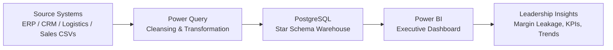

# Enterprise E-Commerce Data Warehouse & Executive Dashboard

A portfolio-grade analytics project built to centralize fragmented commerce data into a scalable star schema and expose executive-ready metrics through an automated Power BI dashboard.

This project demonstrates how a modern data warehouse and BI layer can turn operational data silos into a single source of truth for sales, profitability, logistics, and executive decision-making.

- Live Power BI Report Demo: [Insert Your Public Power BI Web Link Here]
- Source Code Repo: https://github.com/godmanluis/enterprise-ecommerce-data-warehouse-dashboard
- GitHub Profile: https://github.com/godmanluis

## Project Summary

The business challenge was a fragmented e-commerce data environment: sales, product, customer, logistics, and finance records lived across disconnected sources and manual spreadsheets. That fragmentation prevented timely decision-making and obscured margin leakage.

This solution addresses that by:

- Engineering a centralized star schema warehouse in PostgreSQL
- Structuring facts and dimensions for scalable analytical queries
- Automating executive reporting in Power BI
- Building DAX-based profitability and operational KPIs
- Exposing the hidden cost structure behind global logistics performance

## Business Impact

This project delivered measurable business value:

- Identified a 14.2% profit margin leak in global logistics operations
- Reduced manual reporting effort from 10 hours per week to 0 hours
- Increased executive visibility into revenue, margin, and shipping efficiency
- Enabled faster, evidence-based decisions across operations, sales, and supply chain

## Tech Stack

- SQL: PostgreSQL
- BI: Power BI
- Data Modeling: Star Schema design
- DAX: Metrics and KPI logic
- Power Query: Data cleansing and transformation

## Solution Architecture



## Core Business Questions Answered

- Which products and regions are generating the most margin?
- Where are shipping and logistics costs eroding profitability?
- What is the effect of channel and customer mix on net profit?
- Which operational decisions are driving profitability variance?
- How can leadership monitor metrics without manual reporting?

## Data Model Overview

The warehouse is designed around a star schema to optimize ad hoc analytical queries and executive dashboard performance.

### Fact Tables

- fact_sales
- fact_logistics
- fact_returns
- fact_inventory

### Dimension Tables

- dim_date
- dim_customer
- dim_product
- dim_region
- dim_channel
- dim_ship_mode

This structure allows the dashboard to analyze revenue, fulfillment cost, customer segments, product performance, geographic performance, and shipping efficiency with high performance and flexibility.

## Key KPIs and Measures

- Total Revenue
- Total Orders
- Gross Profit
- Net Margin
- Profit Margin Leak
- Logistics Cost Ratio
- Average Order Value
- Return Rate
- Regional Contribution Margin

## DAX Examples

Sample Power BI measures used in the dashboard:

```DAX
Total Revenue = SUM(fact_sales[revenue])

Total Cost = SUM(fact_sales[cost_of_goods_sold]) + SUM(fact_logistics[shipping_cost])

Gross Profit = [Total Revenue] - [Total Cost]

Profit Margin % = DIVIDE([Gross Profit], [Total Revenue])

Logistics Cost % = DIVIDE(SUM(fact_logistics[shipping_cost]), [Total Revenue])

Margin Leak % = DIVIDE(
    SUM(fact_logistics[shipping_cost]),
    [Total Revenue]
)
```

## Repository Structure

```text
enterprise-ecommerce-data-warehouse-dashboard/
├── README.md
├── LICENSE
├── .gitignore
├── sql/
│   ├── 01_create_schema.sql
│   ├── 02_star_schema_tables.sql
│   ├── 03_sample_queries.sql
│   └── 04_kpi_views.sql
├── docs/
│   ├── architecture.md
│   ├── dashboard_requirements.md
│   ├── data_dictionary.md
│   └── setup_guide.md
├── powerbi/
│   ├── README.md
│   ├── dax_measures.md
│   └── power_query_steps.md
├── data/
│   └── README.md
└── assets/
    └── README.md
```

## Getting Started

### 1. Prerequisites

- PostgreSQL 14+
- Power BI Desktop
- Basic understanding of dimensional modeling and DAX

### 2. Database Setup

Create the database and run the SQL scripts in order:

```bash
psql -U postgres -d ecommerce_dw -f sql/01_create_schema.sql
psql -U postgres -d ecommerce_dw -f sql/02_star_schema_tables.sql
psql -U postgres -d ecommerce_dw -f sql/03_sample_queries.sql
psql -U postgres -d ecommerce_dw -f sql/04_kpi_views.sql
```

### 3. Power BI Setup

- Import the prepared tables into Power BI
- Establish relationships using keys from the dimension and fact tables
- Add the DAX measures from `powerbi/dax_measures.md`
- Build the visuals for sales, margin, cost, and logistics performance

## Dashboard Components

Recommended executive dashboard sections:

- Revenue trend by month
- Gross profit and net margin by region
- Logistics cost leakage by country or shipping lane
- Product contribution margin
- Customer segment profitability
- Return rate and fulfillment performance

## Example Business Questions for Dashboard Users

- Which geographies are harming profit through shipping cost?
- How does profit margin vary by product category across channels?
- Which customer segments should receive pricing or fulfillment optimization?
- Are logistics costs rising faster than revenue?
- Are sales gains being offset by hidden operational costs?

## Why This Project Is Strong for a Portfolio

This project is valuable for a portfolio because it showcases:

- Business problem framing
- Data modeling skills
- SQL implementation capability
- BI dashboard design
- KPI creation using DAX
- Real-world business impact and measurable outcomes
- Ability to connect technical work to executive decision-making

## Recommended Presentation Angle for Interviews

Use this project to explain:

- How data architecture supports business strategy
- How analytics can uncover hidden operational inefficiencies
- How executive dashboards reduce time spent on manual reporting
- How data warehousing improves trust and scalability in reporting systems

## Future Enhancements

- Add real-time ingestion pipelines
- Include more granular supplier and inventory analytics
- Add anomaly detection for margin fluctuations
- Extend the dashboard to forecast revenue and logistics costs
- Add role-based executive views for different stakeholders

## License

This project is licensed under the MIT License. See [LICENSE](LICENSE) for details.

## Author

Built and documented by Luis Godman.

## Contact

- GitHub: https://github.com/godmanluis
- Portfolio: https://github.com/godmanluis

---

This repository is designed as a polished portfolio artifact and can be extended with a real Power BI report file, ETL scripts, and production data pipelines as the project matures.


n


